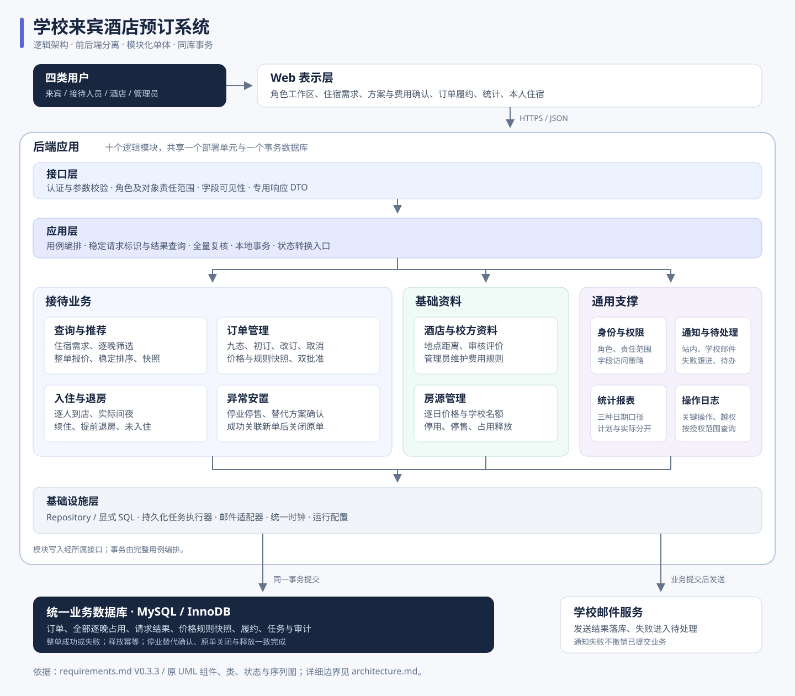
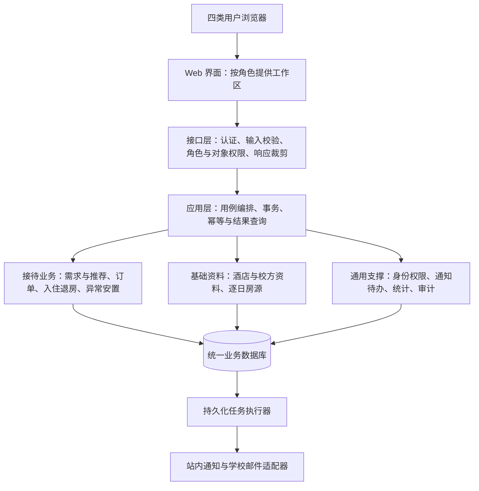
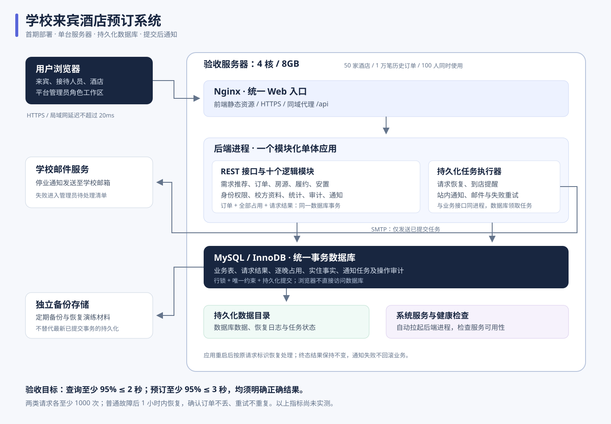

# 学校来宾酒店预订系统架构设计

本架构依据 `requirements.md` V0.3.4 的26条需求、`uml/` 中的六份 UML 源图，以及现有 UI 原型。本文给出技术选型、接口、表名和运行机制等实施建议。性能及恢复指标仍须通过验收验证。

业务层采用前后端分离、模块化单体和关系数据库本地事务。十个业务模块部署在同一个后端应用中，共用一个事务数据库，保持原 UML 组件图的模块边界。预订、改订和安置需要同时修改多类数据，统一事务有利于落实整单成功、失败保留原单和零重复占用的要求。

Windows 桌面包用 WinForms 窗口内嵌 WebView2 和原有 Vue 界面。用户双击 EXE 后，程序从包内启动 Java 后端，通过本机回环地址通信。关闭桌面窗口时，后端通过输入通道关闭信号停止服务。源码、打包脚本和运行数据集中在 `code/`，桌面业务库保存在 `code/data/`。部署图中的 Web 入口也用于开发环境和服务端部署。

## 1. 设计范围与关键决策

| 决策 | 具体设计 | 需求依据 |
| --- | --- | --- |
| 服务对象 | 来宾、学校接待人员、酒店工作人员、平台管理员四类角色；学校管理员与平台管理员为同一角色 | REQ-001 |
| 客户端形式 | Windows 桌面窗口使用内嵌界面，按角色显示工作区。来宾仅查看本人住宿 | REQ-001、024 |
| 部署单元 | 一个后端应用、一个业务数据库；数据库内的任务表支撑通知与恢复处理 | 原组件图、REQ-025、026、027 |
| 一致性边界 | 订单、逐晚价格、规则快照、全部名额变更、请求结果和成功操作日志在同一事务内提交 | REQ-007、015、016、026 |
| 异步边界 | 站内通知、邮件发送及失败跟进在业务提交后执行；业务事务内先保存发送任务 | REQ-027 |
| 价格与规则 | 当前报价用于新方案；确认订单保存逐晚价格与规则快照，后续维护不追改历史 | REQ-003、009、010、013 |
| 数据权限 | 服务端同时检查身份、角色、对象责任范围和字段可见性 | REQ-023、024 |
| 首期建设范围 | 学校代订与线下费用记录；不增加酒店普通预订审批、在线支付或社会用户订房流程 | REQ-001、007、010 |

基线负载为 50 家酒店、1 万笔历史订单、100 人同时使用。先以单体实现并压测；只有测量发现明确瓶颈后，再调整部署规模。首期不依赖分布式锁、独立消息队列或缓存来保证正确性。

## 2. 总体结构



可编辑图源：[系统架构图.puml](uml/系统架构图.puml)；报告插图：[PNG 版本](uml/系统架构图.png)。



分层职责如下。模块是横向业务边界，层是每个模块内部的职责边界，两者不应混为一谈。

| 层 | 负责内容 | 典型对象 |
| --- | --- | --- |
| 表示层 | 表单、候选比较、费用规则确认、请求结果展示、按角色显示页面 | 住宿预订页、酒店房源页、来宾住宿页 |
| 接口层 | HTTP 协议、身份识别、参数格式校验、受权 DTO、错误映射 | Controller、Request/Response DTO |
| 应用层 | 编排完整用例，建立事务，处理请求唯一性，调用多个模块能力 | BookingWorkflow、RelocationWorkflow |
| 领域层 | 订单状态机、名额规则、推荐公式、费用规则、权限策略 | Order、DailyInventory、FeePolicy |
| 基础设施层 | 数据访问、邮件、任务领取、时钟、日志与运行配置 | Repository、EmailGateway、Clock |

接口层不能直接修改数据库。关键业务规则放入领域对象或领域服务；应用层决定一次操作的完整提交范围。跨模块调用使用显式接口，同一数据对象由所属模块负责写入。

## 3. 十个逻辑模块

| 模块 / 建议包名 | 核心责任 | 数据所有权与对外能力 |
| --- | --- | --- |
| 身份与权限 `identity` | 账号、登录、四类角色、接待责任及酒店范围、来宾绑定 | 用户账号、责任关系；提供认证、对象授权和字段策略 |
| 酒店与校方资料 `masterdata` | 酒店档案、接待地点、核实距离、学校审核评价、约定费用规则 | 酒店、地点距离、审核与规则版本；校方字段由管理员维护 |
| 查询与推荐 `search` | 住宿需求录入、计划来宾、条件筛选、整单报价、稳定推荐、方案快照 | 需求、需求明细、需求来宾、报价快照；查询酒店与逐日房源 |
| 房源管理 `inventory` | 本酒店房型、逐日价格及学校名额、维修清洁、停售与占用 | 房型、每日房源、停用记录；提供批量复核、占用和释放接口 |
| 订单管理 `booking` | 初订、改订、整单取消、九态转换、价格与规则快照、特殊改订双方确认 | 订单、订单明细、逐晚预订、规则快照、改订审批；编排名额变更 |
| 入住与退房 `stay` | 逐人登记与补登记、实住间夜、正常/提前退房、续住、晚到与未入住 | 来宾入住事实、实住明细、晚到保留、费用核对；经订单模块改变状态 |
| 异常安置 `relocation` | 停业范围、停售、受影响订单、替代方案、新旧单关联与关闭 | 停业事件、安置记录；编排订单、房源和实住保留 |
| 通知与待处理 `notification` | 站内通知、学校邮件、渠道结果、失败待处理和业务待办索引 | 通知任务、通知记录、待处理项；不直接批准改订或改变订单状态 |
| 统计报表 `reporting` | 下单日期、计划住宿日期、实际住宿日期三种口径和明细追溯 | 受权限限制的只读查询与视图；不反向更新业务数据 |
| 操作日志 `audit` | 操作者、对象、时间、请求关联、结果及越权尝试的留痕查询 | 审计日志；管理员查全部，酒店查本酒店；敏感字段脱敏 |

其中“查询与推荐”承接类图中的住宿需求；“订单管理”仍为订单状态唯一的修改入口。来宾资料由负责人员录入，不能由来宾登录后自行生成预订。

费用规则归 `masterdata` 管理；适用规则快照、预订及取消费用归 `booking`，实住及提前退房费用归 `stay`。共用费用存储契约和唯一来源标识，报表统一读取，不能各自重复记账。

依赖方向：`search → masterdata、inventory`；`booking → masterdata、inventory`；`stay → booking、inventory`；`relocation → search、booking、inventory、stay 的事实查询接口`。身份权限、审计与通知任务通过公共接口接入。避免 `booking` 反向调用 `relocation` 或让待办中心直接写业务表。

## 4. 页面与业务接口映射

沿用现有八张 UI 原型，页面展示可以汇总多个模块，后端责任边界保持清晰。

| 现有页面 | 主要后端模块 | 关键交互 |
| --- | --- | --- |
| UI角色登录 | identity | 登录后按已授权身份进入工作区 |
| UI住宿预订 | search、booking | 需求 → 候选 → 当前报价和规则确认 → 自动预订 → 可查询结果 |
| UI订单与安置 | booking、relocation、notification | 改订差额确认、取消费用、特殊改订待办、停业替代确认 |
| UI每日房源与价格 | inventory | 按日维护本酒店价格与名额，显示已占用量、停用和冲突待处理 |
| UI入住与到店处理 | stay | 逐人入住、补登记、晚到保留、未入住、续住与退房 |
| UI平台管理 | masterdata、identity | 账号、酒店、地点距离、审核评价、规则版本及异常处理 |
| UI接待住宿统计 | reporting | 显式选择日期口径、日期范围与酒店范围 |
| UI来宾本人住宿 | identity、booking、stay | 返回本人姓名、脱敏电话和住宿安排，不返回协议价与他人信息 |

通知待办和审计查询可使用工作区公共入口。原型存在入口不代表拥有权限：例如需求未授权接待人员查询全部操作日志，服务端不得因此扩大其权限。

## 5. 数据架构与核心约束

### 5.1 建议的数据对象

| 数据组 | 建议主要表 | 关键约束 |
| --- | --- | --- |
| 用户及需求 | `user_account`、`guest`、`reception_assignment`、`stay_demand`、`demand_item`、`demand_guest` | 账号绑定来宾；需求和订单关联负责接待人；人数与房型容量须匹配 |
| 酒店及校方资料 | `hotel`、`reception_site`、`hotel_site_distance`、`hotel_review`、`fee_rule_version` | 距离组合唯一；评价可空，有值为 0～100；规则版本可追溯 |
| 房源 | `room_type`、`daily_inventory`、`inventory_block`、`inventory_conflict` | 每日房源唯一键 `(hotel_id, room_type_id, stay_date)` |
| 报价与请求 | `quote_snapshot`、`operation_request` | 报价绑定需求版本；`request_id` 唯一，保存操作者、操作类型、规范化参数摘要和结果 |
| 订单及占用 | `booking_order`、`order_guest`、`order_item`、`order_night`、`order_rule_snapshot`、`order_revision` | 一单一家酒店、相同起止日期；逐晚明细唯一；已确认订单必须有规则快照 |
| 履约及费用 | `guest_checkin`、`actual_room_night`、`fee_record`、`late_arrival_hold`、`extension_request` | 本单每位来宾本次入住记录唯一；实际间夜唯一键 `(order_item_id, stay_date)`；费用来源唯一 |
| 改订与安置 | `special_change_approval`、`hotel_closure`、`relocation_case` | 双方批准绑定具体方案；同一原单同一安置事件仅能成功关联一个替代新单 |
| 通知及审计 | `notification_task`、`notification_delivery`、`work_item`、`audit_log` | 渠道任务以业务事件、接收人、渠道去重；日志关联业务请求及对象 |

这是由类图细化出的逻辑数据模型，最终建表时还需定义外键、索引、字段精度与迁移脚本；本设计不宣称已经建立数据库。

### 5.2 每日名额与价格

住宿区间统一为 **`[入住日, 离店日)`**。例如 10 月 20 日入住、23 日离店，只处理 20、21、22 三晚。

每日房源保存：当前单价、学校名额 `quota`、已占用量 `occupied`、已生效停用扣减 `blocked`、停售标记 `stop_sale` 和销售版本 `sale_version`。

```text
可售量 = stop_sale ? 0 : quota - blocked - occupied
正常可售记录满足：quota >= 0，blocked >= 0，occupied >= 0
                 quota - blocked >= occupied
```

学校名额减少或维修扣减若会突破既有占用，拒绝直接覆盖有效记录，保存冲突待处理项；维修按停用日至恢复日前一天扣减。清洁能在当晚入住前完成时不扣当晚，未满足条件时不能展示可售。停售为独立标记，取消或安置释放占用不会自动解除停售。

`order_night` 保存各晚房数、锁定单价、占用关联及释放标记。占用增加、释放和对应明细必须同事务修改；释放以尚未释放为前提，重复操作影响行数为零。历史实住另行保存，不因释放占用而删除。

整单价 `P = Σ(各明细各晚锁定单价 × 房数)`。金额使用十进制定点数；不能用二进制浮点数结算费用。酒店改价只影响新方案。续住只新增日期及申请时价格，原有晚价不重算。

### 5.3 计划、到店和实住分开保存

`order_guest` 表示计划来宾，`guest_checkin` 表示实际到店人，`actual_room_night` 表示某房型明细某晚实际使用的房间数。三者不能互相替代。

酒店逐人登记；首人入住使订单转已入住，其他人未登记前仍显示未到店。实际用房由酒店核实登记至明细和日期，不能用来宾人数当作房间数，也不能由首人到店推断整单所有房间已经实住。实际间夜只入账已发生并核实的住宿晚，可由夜间任务产生待核实记录，不能提前将未来晚计入实际。

停业关闭保留原单已住日期与费用。替代单只承接剩余住宿区间，原单剩余计划被标记为已转移，不再作为有效计划重复统计。

## 6. 核心流程与事务设计

### 6.1 查询、报价与推荐

先验证需求及责任关系，要求 `B > 0`、`D > 0`，D 默认 20 公里且可缩小；接待地点来自管理员档案。再筛选城市、日期、每晚价格区间、房型房数、人数容量、酒店审核、评价、距离和逐晚库存。

只有全部明细全部住宿晚有房、`P ≤ B`、`d ≤ D`、审核通过且 `E ≥ 70` 的酒店才能参与推荐或预订。缺少某晚价格、名额或学校评价不能视作合格。预算、距离和质量门槛不自动放宽。

```text
S = 0.4 × 100 × (1 - P/B) + 0.3 × 100 × (1 - d/D) + 0.3 × E
排序：S 降序 → P 升序 → d 升序 → E 降序 → 酒店编号升序
```

排序使用未显示舍入的值。为避免有限精度除法改变先后，同一次查询 B、D 相同，可用十进制精确运算比较 `400(B-P)D + 300(D-d)B + 3EBD`，展示时再除以 `10BD`。给定 B=1000、P=500、D=20、d=10、E=80，显示前评分为 59。

服务端保存报价快照，包含需求版本、酒店资格、逐晚价格与可用量/销售版本、距离、规则版本和整单价。前端提交快照标识，不能自带最终成交金额。快照用于比较，不锁房。

### 6.2 幂等、自动预订和旧页面复核

对初订、改订、取消、续住、入住退房和替代安置等写操作统一使用请求标识。初订处理如下：

1. 认证并检查接待责任、输入及报价归属；以独立短事务持久化 `operation_request=PENDING`。保存足够恢复执行的命令参数，并控制其中的敏感资料访问。
2. 同一 `request_id`、同一操作者、同一操作和相同参数摘要返回原进度或原终态结果。同标识配不同参数返回请求冲突；不同来宾的独立合法请求不互相去重。无权限用户不能查到他人的原结果。
3. 执行事务锁定该请求，取得唯一处理权；再按固定顺序锁定相关酒店基础记录和全部逐日房源，重新读取资格、规则、价格与可用量。事务内再次复核，不能仅依赖事务外查询。
4. 任一晚名额不足或不再满足原条件：整单拒绝，不做部分占用；保存确定失败结果及日志。初次预订的确定业务失败可落为无占用的“预订失败”订单；改订失败不改变原订单状态。替代酒店查询在事务外按原条件进行。
5. 价格变化，或名额变化但仍足够，或待确认规则变化：保存 `NEEDS_RECONFIRMATION` 和最新方案摘要；本次不生成已确认订单或占用。接待人员确认新方案后使用新请求标识。
6. 方案未变化且合格：在一个事务中创建订单并由预订中转已确认，保存来宾与全部明细、逐晚锁定价、规则快照，增加全部占用，保存 `SUCCEEDED`、操作日志及需要的通知任务，随后提交。

请求进度至少包括 `PENDING / SUCCEEDED / REJECTED / NEEDS_RECONFIRMATION`，与订单九态独立。预订中可在事务内短暂存在，不需要让酒店审批。确定结果一旦提交就不因重试改写。

业务拒绝通过结果分支提交请求结果，且不提交名额变更。技术异常导致事务回滚时，不能把同一事务里写的失败记录当作已经持久化；原请求仍为 PENDING，由恢复任务重新执行。提交响应丢失或数据库连接异常时，先按原请求查询，不能推断失败并创建新请求。

### 6.3 并发锁与统一写入规则

采用数据库事务和行锁保证正确性。所有相关写入口，包括酒店调价调名额、维修、停售和恢复任务，都遵守同一锁协议。

- 全局顺序：请求记录 → 当前账号（管理员先按编号锁定管理员账号）→ 酒店根记录（酒店编号升序）→ 既有订单（订单编号升序）→ 相关需求/规则/距离等基础记录（固定类型与主键顺序）→ 每日房源（酒店、房型、日期升序）→ 履约和费用记录。账号删除与业务命令共用账号锁，写事务采用 READ COMMITTED，取得锁后读取最新状态。
- 正常业务对酒店资格根记录加共享锁，停业及影响资格的维护加排他锁；每日房源按唯一键读取并加排他锁。缺少某晚记录视作不可订，不临时虚构容量。
- 停业先锁酒店根记录，再查找并锁定受影响订单。并发预订必须经过同一根记录锁，从而不会漏掉停业生效前刚确认的订单，也不会在停售后确认新单。
- 改订或安置涉及两家酒店时，先统一排序锁定涉及酒店，再锁订单及新旧全部房源。若预读到的订单酒店关系在加锁后改变，回滚后重新读取，不能继续使用旧锁集合。
- 先锁定并检查全部明细，再修改；配合条件更新和影响行数复核。最后一间房的并发争用只有一个请求能成功。
- 只对已确认回滚的死锁或瞬时锁冲突做有限重试；重试仍使用原请求。不能靠进程内互斥锁保护数据库库存。

Java 实现时，跨模块业务写入使用同一数据源与同一事务传播范围。Spring 事务入口必须经代理调用，并明确配置业务异常的回滚行为；不能在内部自调用方法上加注解就认为事务必然生效。[Spring 事务说明](https://docs.spring.io/spring-framework/reference/data-access/transaction/declarative/annotations.html)。库存锁定读取基于 InnoDB 的事务锁定机制。[MySQL 锁定读取说明](https://dev.mysql.com/doc/refman/8.4/en/innodb-locking-reads.html)。

### 6.4 改订、取消及续住

| 用例 | 校验及确认 | 同一事务内的变更 | 失败结果 |
| --- | --- | --- | --- |
| 普通改订 | 原单已确认；时间早于入住前一日 18:00；新整单价和差额已确认 | 锁定新旧名额，检查后按差额调整占用，保存新明细、价格和版本历史；状态保持已确认 | 原单及原占用不变 |
| 特殊改订 | 18:00 整及以后；管理员与酒店均批准同一方案，负责接待人确认差额；执行时仍须已确认 | 与普通改订相同，额外保存双确认记录；方案变化后旧批准失效 | 不能绕过订单状态或新库存校验 |
| 整单取消 | 负责接待人操作已确认且未入住订单 | 状态转已取消；释放全部应释放占用；按快照记录取消费及日志 | 重复请求返回原结果，不二次释放 |
| 续住 | 原单已入住；新增每晚有房；接待人确认申请时的报价 | 新增逐晚明细和占用；保存新增价格；原已住晚价不变，状态保持已入住 | 原住宿保持有效 |
| 提前退房 | 本酒店人员登记实际离店日；核实已住事实 | 记录实际离店，释放之后未住日期；保存实住、独立额外费用及核对待办；转已退房 | 不按未展示的新规则收费，争议交管理员 |

改订可用量需考虑本订单已有占用。相同房型日期按 `新需要量 - 原占用量` 核算增量，不能要求本单再额外拥有一整份库存；完成新方案确认前也不能先提交原占用释放。

取消费用以学校统一配置的业务时区计算截止时间：`入住日期前一日 18:00`。早于截止为 0；从整点起为各房型房数乘各自锁定首晚价后求和。两间首晚锁定价 200、300，整点起整单取消费为 500。记录应付不代表已付款。

未入住费用及提前退房额外费用由已展示并保存的约定规则处理；需求未明确的费率不在架构中自行补定。费用类别至少区分住宿、取消、未入住和额外费用。

### 6.5 入住、未入住和订单状态

| 当前状态 | 允许的目标状态或保持状态的操作 |
| --- | --- |
| 预订中 | 全量成功 → 已确认；确定失败 → 预订失败 |
| 已确认 | 首位实际来宾登记 → 已入住；整单取消 → 已取消；酒店登记未入住 → 未入住；停业 → 待安置；成功改订保持已确认 |
| 已入住 | 正常/提前退房 → 已退房；停业 → 待安置；同单来宾补登记或续住保持已入住 |
| 待安置 | 仅在替代新单成功确认时 → 已关闭（停业）；未确认或替代失败保持待安置 |
| 已取消、预订失败、未入住、已退房、已关闭（停业） | 终态，不能恢复为已入住；需要住宿时重新发起符合条件的新订 |

首次入住要求已确认；补登记要求已入住、本单来宾且未重复登记。不能把同单尚未到店的其他人自动标记为到店，也不能对已有实际入住的整单执行未入住转换。

计划入住日 24:00 按次日 00:00 调度核实提醒，通知本酒店与负责接待人；默认保留至次日 12:00。无另行晚到保留时，由酒店在该时点后登记未入住并释放后续名额。调度器只生成提醒，不能自动判定未入住。另行保留保存实际期限、操作者和原因；登记未入住后晚到须新订。

日期计算通过可替换的统一时钟和学校业务时区完成，示例按 UTC+8；不使用各浏览器时钟决定权限截止。每次业务执行重新校验状态与时间，旧页面和待办都不能跳过。

### 6.6 停业与替代安置

停业分为两个业务事务，通知另行执行：

**事务一：停业生效。** 锁定酒店及受影响订单、房源，停售受影响日期；为已确认或已入住的受影响订单建立安置记录并转待安置，保留原占用。已入住订单先保存酒店核实的实住与费用，未完成核实时保留待核实事项，不得将已住事实清空。保存负责接待人员的站内和邮件通知任务、审计记录后提交。

**事务二：接待人员确认替代。** 按原住宿条件查询合格候选，已入住订单只安排剩余日期。用户确认后复核新报价，在同一事务中完成替代新单确认、全部新占用、原单关闭、原占用释放、新旧单关联和安置请求结果。任一步失败或需要重新确认，整体不生效，原单仍待安置且原占用保留。

在同一原单上加锁并检查安置关联，使两个不同请求也不能各创建一个成功替代单。原单已关闭时返回既有替代关联。停售不随原占用释放而解除；原单实住和费用继续供历史统计。

### 6.7 通知、待办与失败恢复

使用数据库任务表实现提交后投递：业务事务写入发送任务，后台执行器领取已提交的任务并调用站内通知或学校邮件服务。任务包含业务事件、对象、接收人、渠道、尝试次数、下次执行时间和执行结果。

停业面向负责接待人员使用站内通知和学校邮箱双渠道。未到店核实及未入住登记的渠道需求未另约定，首期建议使用站内通知；这是实现建议，不宣称是已确认的新增需求。

失败立即生成管理员可见待处理项，同时可做有上限、带退避的自动重试；成功后更新处理结果。任务租约到期可重新领取，进程退出不丢任务。站内通知用唯一键避免重复；普通 SMTP 可能在发送成功后、结果落库前发生故障，因此邮件采用至少一次尝试并保留投递追踪，不能承诺绝无重复，也不能把发送成功当成已读。

特殊改订双方确认、续住确认、费用核对及争议通过待办聚合。待办跳转回所属业务接口处理，处理时再次校验方案、状态和权限。邮件调用不能放在订单数据库事务中。

## 7. 权限与资料可见性

| 角色 | 对象范围 | 联系方式与敏感信息 |
| --- | --- | --- |
| 来宾 | 账号绑定本人、本人的住宿安排 | 本人姓名、脱敏电话、酒店地址、日期、房型和状态；不返回他人、协议价和管理记录 |
| 学校接待人员 | 自己负责的需求、来宾、请求与订单 | 可见必要联系方式和负责订单价格；不能修改地点、审核与费用规则 |
| 酒店工作人员 | 本酒店房源与接待订单 | 可见接待所需联系方式；不能读取其他酒店数据或修改学校审核 |
| 平台管理员 | 账号、校方资料、全局管理与异常处理 | 默认电话脱敏；具体异常下提交原因后，通过独立接口受控查看完整号码并记录时间 |

建议使用服务端会话，浏览器通过 HttpOnly、Secure、SameSite Cookie 携带会话标识，写接口配置 CSRF 防护。数据库维护必要会话状态，应用重启后可重新登录，业务请求仍通过原请求标识追溯。

授权采取“角色允许动作 + 对象归属匹配 + 字段策略”三步检查。列表查询先应用数据范围，按编号获取、修改、导出、请求结果查询和通知读取也分别检查。`hotel_id`、接待负责人等上下文由服务端判断，不信任前端传入的归属声明。

按角色返回独立 DTO，来宾接口不序列化完整订单后再在页面隐藏价格。日志不记录明文电话、密码、会话或整包请求；管理员完整号码查看只记录原因和访问事实。成功审计随业务事务提交；越权拒绝与失败审计使用独立短事务写入，避免业务回滚把拒绝记录一并清掉。

## 8. 接口契约建议

本次增加了管理员酒店与账号的逻辑删除，含关联业务保护、旧报价和登录失效、历史统计保留，详见[删除功能与需求一致性说明](code/docs/deletion-policy.md)。

所有路径以 `/api` 为前缀。下列接口展示边界，并非已经实现的 API。

| 接口示例 | 用途 | 特别约束 |
| --- | --- | --- |
| `POST /session`、`DELETE /session` | 登录、退出 | 账号状态及角色来自服务端 |
| `POST /demands`、`PUT /demands/{id}` | 需求与来宾资料 | 接待责任校验；更新带版本号 |
| `POST /hotel-options/search` | 查询与推荐 | 返回合格候选及服务端方案快照 |
| `POST /bookings` | 确认预订 | 报价标识、需求版本、`Idempotency-Key` |
| `GET /requests/{requestId}` | 查询原请求处理结果 | 仅发起人或明确授权的关联人员可读 |
| `POST /bookings/{id}/changes` | 提交已确认的新改订方案 | 差额确认、原订单版本、必要的双批准记录 |
| `POST /change-approvals/{id}/confirmations` | 管理员或酒店确认特殊改订 | 身份来自当前会话，绑定方案摘要 |
| `POST /bookings/{id}/cancellations` | 整单取消 | 使用快照计算费用、幂等释放 |
| `POST /bookings/{id}/check-ins` | 逐人入住及补登记 | 指定本单来宾，不批量虚构到店 |
| `POST /bookings/{id}/extensions`、`POST /extensions/{id}/confirmations` | 提出续住、负责接待人确认 | 确认时复核新增日期库存与申请报价 |
| `POST /bookings/{id}/check-outs` | 正常或提前退房 | 酒店权限，保存实际离店与实住事实 |
| `POST /bookings/{id}/late-arrival-holds`、`POST /bookings/{id}/no-shows` | 晚到保留、酒店登记未入住 | 服务端时间及状态校验 |
| `PUT /hotels/{id}/daily-inventory` | 每日价格与名额维护 | 仅本酒店；版本冲突与占用下限检查 |
| `POST /hotels/{id}/closures` | 酒店确认停业范围 | 原子停售及受影响订单处理 |
| `POST /relocations/{id}/confirmations` | 确认替代新单 | 新旧单与库存同事务提交 |
| `GET /me/stays` | 来宾本人住宿 | 专用脱敏响应，无协议价 |
| `GET /reports/stays?basis=actual&from=...&to=...` | 三种统计口径 | basis 为 created/planned/actual；范围强制过滤 |
| `POST /exceptions/{id}/contact-accesses` | 管理员异常查看完整号码 | 具体异常、业务关联、原因和审计不可缺少 |

响应包含 `requestId`、稳定的 `businessCode`、必要的 `orderId`、方案版本及授权范围内的展示数据。区分 `BOOKED`、`INSUFFICIENT_INVENTORY`、`NEEDS_RECONFIRMATION`、`STATE_CONFLICT` 和 `REQUEST_PAYLOAD_CONFLICT` 等业务结果。处理中返回 202 和查询入口；终态请求重复提交返回相同业务结果。HTTP 超时本身不代表预订失败。

## 9. 统计读模型

报表直接从业务数据库的受控只读查询或视图读取，首期不增加单独统计数据库。三个口径使用各自日期字段过滤，页面、导出和钻取必须一致。

| 口径 | 主要来源 | 统计规则 |
| --- | --- | --- |
| 下单日期 | `booking_order.created_at` | 查询新增订单，按状态分列；不把下单日期当作住宿日期 |
| 计划住宿日期 | 有效版本 `order_night.stay_date` | 有效预订为已确认、已入住、已退房；按筛选日期逐晚汇总计划房数和金额，提前退房移除未住计划，改订只用当前有效版本 |
| 实际住宿日期 | `actual_room_night.stay_date` | 只累计截至统计时已住且核实的间夜，直接关联该晚锁定价；停业关闭原单已住部分仍保留 |

预订人次按订单内来宾关系累计，同人多次订房计多个人次；去重人数按来宾身份另算。先分别聚合来宾和间夜，再组合报表，避免一对多关联把人数、间夜和金额乘倍。

取消、预订失败、未入住及相关费用独立分项；住宿、取消、未入住、额外费用分列，费用有核对状态和来源。新旧停业单依据转移范围分段统计，不能对原单剩余晚和替代单再次求和。示例：两间房计划三晚为 6 间夜，各实际住两晚为 4，未来计划为 2；只筛一晚则只取该晚的 2 间夜。

酒店报表强制本酒店，接待人员限制负责范围，管理员可查全校。任何汇总、明细、去重人数和导出都复用同一权限范围。

## 10. 技术落地与工程组织

可采用以下实现组合；具体发行版本在立项时锁定兼容且仍维护的版本，不把框架版本写成业务架构约束。

| 部分 | 建议方案 | 使用目的 |
| --- | --- | --- |
| 前端 | Vue 3 + TypeScript | 复用现有角色工作区原型，按组件维护预订与履约页面 |
| 后端 | Java + Spring Boot，统一安全与事务配置 | 组织模块、REST 接口、权限、定时任务和数据库事务 |
| 数据访问 | 以显式 SQL 为主的 Repository | 明确逐晚批量读取、锁定顺序和受控更新 |
| 数据库 | MySQL / InnoDB | 事务、行锁、唯一约束和持久化恢复 |
| Web 入口 | Nginx | HTTPS、静态资源与 `/api` 同域代理 |
| 通知 | 持久化任务 + 后台执行器 + 学校 SMTP | 提交后发送、可恢复重试及失败跟进 |

Vue 的组件化界面能力可参考[官方介绍](https://vuejs.org/guide/introduction.html)。事务与锁的实现依据见第 6.3 节；以上是针对本项目规模的选型建议，不是唯一可行组合。

建议目录按业务模块组织，每个模块内部再分层，避免所有 Controller、Service、Mapper 混为三个全局大目录。

```text
frontend/src/
  app/                       # 登录、会话、路由及角色工作区
  features/
    booking/ inventory/ stay/ relocation/ admin/ reports/ guest/
  shared/                    # 公共组件、协议类型、请求封装
backend/src/main/java/.../
  identity/ masterdata/ search/ inventory/ booking/
  stay/ relocation/ notification/ reporting/ audit/
    api/                     # 模块对外契约与 HTTP 适配
    application/             # 完整用例、幂等和事务编排
    domain/                  # 规则、状态机、领域对象
    infrastructure/          # SQL、适配器与持久化实现
  shared/                    # 错误协议、请求上下文、时钟等小范围公共能力
backend/src/main/resources/
  db/migration/              # 可追溯数据库结构变更
deploy/                      # 部署配置、备份及恢复说明
```

此处是拟建目录，并未生成前后端工程。仅通知/任务等基础设施需要的能力进入公共包，不把订单、库存等领域对象抽入一个可被任意修改的公共实体包。

## 11. 部署、性能与恢复



可编辑图源：[系统部署图.puml](uml/系统部署图.puml)；报告插图：[PNG 版本](uml/系统部署图.png)。

验收基线可在一台 4 核 8GB 服务器部署 Nginx、后端进程和 MySQL，使用持久化数据目录；浏览器通过局域网访问，学校邮件是外部依赖。任务执行器首期与后端同进程，使用数据库任务状态与领取锁防重复执行。数据库仅对后端及运维开放，凭据置于受控运行配置中。

**性能设计。** 查询先按酒店资格、城市与距离缩小候选，再批量读取日期区间内的房源；不能每家酒店、每一晚分别请求数据库。索引至少覆盖每日房源唯一键、酒店地点组合、订单酒店/状态/住宿日期、负责接待人/下单时间、逐晚日期及订单、实住日期及明细、待执行任务状态/计划时间。控制分页、连接池与锁等待，邮件发送不占预订事务时间。具体复合索引顺序以实际 SQL 和执行计划调整。

按 REQ-022 在网络延迟不超过 20ms、50 家酒店、1 万历史订单、100 人同时使用的环境中，分别采样至少 1000 次查询和 1000 次预订；每类至少 950 次在 2 秒和 3 秒内取得明确正确结果。确定无房属于业务结果，结果不明的超时不能从样本中剔除。该指标为验收目标，尚未实测。

**故障恢复。** 应用由系统服务自动拉起；数据库数据、请求表、占用和任务都保存在持久化存储。配置数据库已提交事务的持久化机制，普通进程退出、重启和短暂断网后依赖事务恢复读取原数据。备份用于额外恢复保障，不能用旧备份覆盖现库来声称最新已确认订单未丢失。

恢复后先验证数据库与业务表可读，再恢复请求和通知任务；PENDING 请求按原标识重做，已终结请求返回原结果。定期核对逐日占用与未释放订单明细，发现差异生成告警和待核查项，不能无依据自动清空占用。

验收需分别模拟应用异常退出、服务器重启、短时网络中断，检查 1 小时内恢复查询和预订，逐笔比对故障前已确认订单与库存，且重试零重复。该方案针对需求规定的普通故障范围，是否达标取决于实际持久化配置与演练结果。

## 12. 需求追踪与关键验收

| 需求 | 架构落点 | 必须验证的关键场景 |
| --- | --- | --- |
| REQ-001 | 四角色、服务端权限和角色工作区 | 校方与酒店边界，来宾不能订房 |
| REQ-002 | masterdata 审核、评价、地点与距离 | 评价 69/70/空值，非管理员不能改审核 |
| REQ-003 | inventory 逐日价格名额及停用冲突 | 锁定价不追改、名额不得覆盖既有占用 |
| REQ-004 | search 需求与来宾、booking 单酒店同日期约束 | 多房型合单，不同酒店或日期拆单，B/D 非正拒绝 |
| REQ-005 | 逐晚完整筛选与整单报价 | P=B、d=D、某晚无房、房型容量和价格区间 |
| REQ-006 | 归一化公式及精确排序 | 示例 59、各级同分排序、显示舍入不改变顺序 |
| REQ-007 | BookingWorkflow 全量事务、报价快照及锁内复核 | 多房型同单成功并锁价。改价或名额变化但方案仍合格时重新确认，确认前零占用。任一晚不足时整单失败并提示替代选项。普通预订无酒店审批。 |
| REQ-008 | booking 唯一状态转换入口 | 九态合法/非法转换及终态不恢复 |
| REQ-009 | 改订版本、差额确认、双批准方案绑定 | 18:00 前/整点/后，失败保留原单 |
| REQ-010 | 规则快照、取消费用与幂等释放 | 17:59:59 为 0，18:00 为首晚锁定价总和 |
| REQ-011 | guest_checkin 与订单分离 | 首人入住、后来补登记、重复/跨酒店拒绝 |
| REQ-012 | 退房事实与终态保护 | 重复退房无第二事实，退房后不能入住 |
| REQ-013 | 新增晚价、实际离店与独立额外费用 | 续住失败不改原单，提前退房释放未来日期 |
| REQ-014 | 提醒任务、晚到保留、酒店人工判定 | 24:00 提醒、次日 12:00 边界、未入住后须新订 |
| REQ-015 | 逐日占用、释放标记及独立停售 | 左闭右开日期、停售不随释放解除 |
| REQ-016 | operation_request 唯一约束及结果查询 | 同请求连续/并发/响应丢失重试只产生一份结果 |
| REQ-018 | 原条件替代查询与人工确认 | 合格替代或无方案，不自动替换 |
| REQ-019 | 停业两阶段事务与安置关联 | 失败保留原单占用，成功同时确认新单并关闭原单 |
| REQ-020 | 业务成功审计及独立拒绝日志 | 按对象/操作者/时间回查，酒店只能查本店 |
| REQ-021 | 三种日期读模型与分类费用 | 计划 6、实际 4、未来 2，停业分段不重不漏 |
| REQ-022 | 批量查询、索引及压测方案 | 基线环境分别 1000 次，至少 950 次满足时限 |
| REQ-023 | 角色、对象、查询及命令全路径授权 | 改编号、直接请求、旧页面越权成功数为零 |
| REQ-024 | 专用 DTO、字段策略、异常号码访问 | 响应与日志同范围，无协议价或电话越权泄露 |
| REQ-025 | 持久化数据库、请求恢复和服务拉起 | 三类普通故障 1 小时内恢复，确认订单不丢 |
| REQ-026 | 统一锁序、整单事务、幂等与状态版本 | 最后一间并发、部分不足、失败改订、重复安置 |
| REQ-027 | 事务内任务、提交后双渠道投递及待处理 | 邮件失败可追踪，不撤销安置，不虚构已读 |

优先实现并验证“需求查询 → 报价确认 → 自动预订 → 请求查询 → 逐人入住 → 实住及退房”的主链路；随后接入改订取消、续住与未入住、停业安置、统计与恢复演练。每个阶段都保留权限、幂等和审计，不能留到最后补上。
